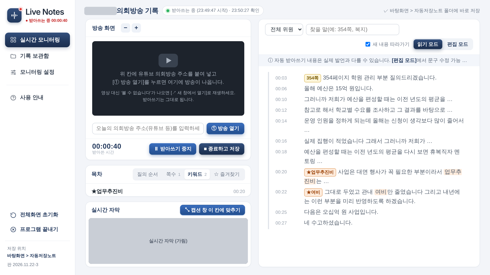

# Live Notes (의회방송 모니터링)

유튜브 실시간 방송 등 동영상을 보면서 Windows 11의 **라이브 캡션** 자막을 내 컴퓨터(바탕화면 `자동저장노트` 폴더)에 글로 저장해 주는 도구입니다. 설치나 관리자 권한 없이 압축만 풀어서 씁니다.

유튜브 의회방송뿐 아니라 국정감사, 설명회, 기자회견, 강연 등 다양한 동영상에서 쓸 수 있습니다.

> 개인이 만든 업무 보조 도구이며, 기관의 공식 프로그램이 아닙니다.
> Windows 11 PC에서만 동작합니다.

*받아쓰는 중인 화면 (시험용 예시 내용)*

**판: 2026.11.26** · 내 프로그램의 판은 화면 왼쪽 아래나 `★처음 읽어 주세요` 첫 줄에서 볼 수 있습니다.

## 내려받기

1. **[여기를 눌러 내려받기](https://github.com/jinyoung-plus/live-notes/releases/latest/download/live-notes.zip)** (`live-notes.zip`, 늘 최신 판)
2. 브라우저가 "일반적으로 다운로드되지 않는 파일"이라고 막으면 **[…] → [유지]**를 누릅니다.
3. 압축 파일을 오른쪽 클릭 → **[모두 압축 풀기]**로 풉니다.

새 판이 나오면 같은 링크로 받아 압축을 새로 풀어 쓰세요. 바탕화면 `자동저장노트` 폴더의 기록과 설정(위원 명단·관심 키워드)은 그대로 남습니다.

## 사용 순서

1. `Live Notes 실행` 더블클릭 (Live Notes 화면이 브라우저에 열림)
   - "Windows의 PC 보호" 창이 뜨면 **[추가 정보] → [실행]**
   - 처음 실행하면 자막 창(Windows 라이브 캡션)에서 **[동의]**를 누르고 한국어 음성 인식 파일을 내려받기 (처음 한 번만)
2. 방송 주소 붙여 넣기 → **[① 방송 열기]** → 재생 → **[② 새 기록 시작]**
3. 쉬는 구간은 **[⏸ 받아쓰기 중지]**, 다시 기록할 때 **[▶ 받아쓰기 재개]**
4. 끝나면 **[■ 종료하고 저장]** (다시 시작하면 새 파일)
5. 모두 마치면 왼쪽 아래 **[Ⓧ 프로그램 끝내기]** 또는 브라우저 창 닫기

※ 저장 위치: 바탕화면 `자동저장노트` 폴더
※ 파일 이름: `날짜_01_자동저장노트.txt` (같은 날 02, 03 …)

## 주요 기능

- **실시간 모니터링**: 방송을 보면서 받아쓴 내용을 바로 파일에 저장. 아직 저장 전인 말은 맨 아래 **말하는 중** 줄에 표시
- **자막 창 자동 최소화**: 첫 자막이 나오면 자막 창(라이브 캡션)과 검은 실행 창을 작업 표시줄로 내려 화면을 가리지 않음. 자막은 화면 왼쪽 아래 '실시간 자막' 칸에 표시
- **기록 보관함**: 지난 받아쓰기 파일을 골라 다시 보고 오타도 고침. [📁 폴더 열기]로 저장 폴더 열기
- **모니터링 설정**: 위원 명단을 넣으면 위원별 질의 구간을 나누고, 부서명·사업명 등 관심 키워드가 나오면 강조하고 알림음
- **받아쓰지 못한 구간 표시**: 자리를 비워 화면이 잠기거나 화면 보호기가 켜진 동안은 받아쓸 수 없으므로, 그 구간을 본문과 목차에 `⚠ 받아쓰지 못한 구간 (실제 시각 …)`으로 표시하고 화면에 알림
- **정회·속개 구분선**과 위원 질의 구간 인식 보완(소관 종료, 호명·위원장 질의 표현 등)
- **즐겨찾기**: 받아쓴 줄의 시각을 두 번 누르면 ★ 표시. 목차에 모이고 `…_즐겨찾기.txt`에도 남음
- **편집 모드**: 문장을 눌러 오타를 바로 고치면 저장 파일에도 반영
- 질의 순서·쪽수·키워드·즐겨찾기 목차
- 퍼가기가 막힌 방송은 [↗ 새 창에서 열기]로 재생 (방송 칸은 자동으로 멈춰 소리가 겹치지 않음)
- 유튜브가 아닌 방송 주소(의회 방송 누리집, 네이버 라이브 등)도 새 창으로 열어 받아쓰기

## 꼭 알아 두세요

- 자동 받아쓰기 내용은 실제 발언과 다를 수 있습니다. **숫자와 이름은 다시보기 영상으로 확인**한 뒤 쓰세요.
- 받아쓰는 동안 자막 창과 검은 실행 창은 작업 표시줄에 내려가 있습니다. 닫지 마세요.
- 화면이 잠기거나 화면 보호기가 켜진 동안은 받아쓰지 못합니다. 저장 파일의 `⚠ 받아쓰지 못한 구간`은 다시보기로 확인하세요.
- PC 소리를 끄면 자막이 안 나오는 PC도 있습니다. 그때는 이어폰을 꽂아 주세요. 유튜브 화면 안의 음소거는 하지 마세요.
- 자막 창이 작업 표시줄로 내려가지 않으면 자막 창 ⚙ → 위치 → **[화면에 오버레이 됨]**을 고르세요.
- 압축을 푼 뒤 `프로그램 구성 파일` 폴더 안의 파일은 옮기거나 지우지 마세요.
- 받아쓴 내용은 내 PC에만 저장되며 인터넷으로 보내지 않습니다.
